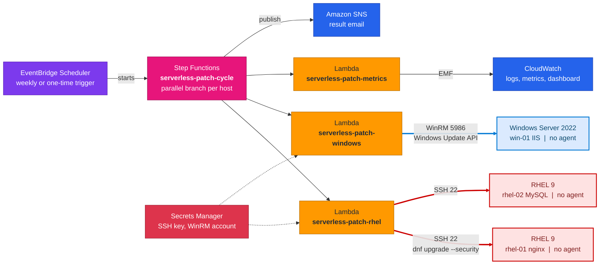

# Centralized Agentless Patch Management using Serverless Orchestration

A serverless framework on AWS that patches Red Hat Enterprise Linux 9 and Windows Server 2022 hosts
**without installing any agent**. A Lambda function reaches each host over its built-in remote protocol
(SSH for RHEL, WinRM for Windows), and AWS Step Functions orchestrates the patch cycle.



Region `ap-southeast-5` (Asia Pacific, Malaysia). All resources are tagged `project=serverless-patch`.

## Repository layout

| Path | Purpose |
|---|---|
| `config.ps1` | Shared settings (account, VPC, hosts, baseline AMIs, resource names) and helper functions. Dot-sourced by every script. |
| `lambda/patch_rhel.py` | RHEL actions over SSH: precheck, scan, install_start, install_status, reboot, health |
| `lambda/patch_windows.py` | Windows actions over WinRM: same six actions; installs through a one-shot SYSTEM scheduled task |
| `lambda/metrics.py` | `serverless-patch-metrics`: per-host and per-cycle records (EMF metrics), cost estimate, email text |
| `lambda/summary_widget.py` | `serverless-patch-summary-widget`: CloudWatch custom widget (coloured Patch Summary panels) |
| `statemachine/patch-cycle.asl.json` | Step Functions workflow `serverless-patch-cycle` (JSONata, parallel Map over hosts) |
| `iam/*.json` | Trust and permission policies (least privilege) |
| `dashboard/dashboard-v3.json` | CloudWatch dashboard `PatchManagement-Dashboard` (template; `dashboard-v2.json` is the earlier layout) |
| `deploy-framework.ps1` | Deploys the patch Lambdas, IAM roles, state machine and the weekly schedule (created disabled) |
| `deploy-monitoring.ps1` | Deploys visibility: SNS topic, metrics Lambda, custom widget Lambda, dashboard. `-DashboardOnly` redraws the dashboard |
| `deploy-site.ps1` | Publishes the project website (`site\`) on CloudFront from a private S3 bucket. `-SkipBuild` uploads without rebuilding the data |
| `lab.ps1` | `status`, `start-rhel`, `start-win`, `start-all`, `stop-all`, `endpoint-up`, `endpoint-down` |
| `test-rhel.ps1`, `test-win.ps1` | Read-only precheck and scan, calling the Lambdas directly |
| `run-cycle.ps1` | Starts one patch cycle (`-Mode scan` or `-Mode patch`) and follows it to the end |
| `restore-baseline.ps1` | Returns hosts to their unpatched baseline AMI (EC2 replace root volume) |
| `exp3-scale.ps1` | Experiment 3 (scalability): launch clones, run levels from baseline, teardown |
| `evidence/` | Results of every test, cycle, restore and deploy (JSON, CSV) |
| `site/` | Project website: landing page and results dashboard built from `evidence/` (see [Project Website](#project-website)) |
| `build/` | Generated files (not in the repository) |

## Prerequisites

- Windows workstation with **PowerShell 7** and **AWS CLI v2**, signed in with `aws login`
- The testbed from the build record: VPC, three hosts frozen as baseline AMIs, Secrets Manager secrets,
  Lambda layer `serverless-patch-remote-libs` (Paramiko, pywinrm) and the Lambda execution roles
- Run every script from this folder:

```powershell
cd 'C:\AWS Project\deployment'
Get-ChildItem -Recurse | Unblock-File      # only needed for files that came from a download
```

## Deploy

```powershell
.\lab.ps1 endpoint-up          # Secrets Manager interface endpoint (billed hourly while it exists)
.\deploy-framework.ps1           # patch Lambdas, Step Functions, Scheduler
.\deploy-monitoring.ps1           # SNS email, metrics Lambda, custom widget Lambda, dashboard
```

Both deploy scripts are safe to run again. Confirm the SNS subscription email once. The first time the
dashboard opens, allow its custom widgets ("Allow always").

## Run

| Step | Command | Changes hosts? |
|---|---|---|
| Start hosts | `.\lab.ps1 start-all` (or `start-rhel` / `start-win`) | No |
| Read-only checks | `.\test-rhel.ps1`, `.\test-win.ps1` | No |
| Scan cycle | `.\run-cycle.ps1` | No |
| Patch cycle | `.\run-cycle.ps1 -Mode patch -ViaSchedule` | **Yes** (type `PATCH`) |
| Partial cycle | `.\run-cycle.ps1 -Mode patch -Percent 5` | **Yes** (highest severity first) |
| One host only | `.\run-cycle.ps1 -Mode patch -Targets serverless-patch-win-01` | **Yes** |
| Back to baseline | `.\restore-baseline.ps1 -Target rhel-01,rhel-02,win-01` | **Yes** (type `RESTORE`) |
| Shut down | `.\lab.ps1 stop-all`, `.\lab.ps1 endpoint-down` | No |

Windows follow-up passes (iteration 3): the Windows Recovery Environment update (KB5131594) is often still
offered after the first pass, because it only takes effect once Windows has finished servicing the cumulative
update. The cycle therefore reinstalls any selected update the rescan still finds, up to `-Followups` times
(default 2), each after a wait (`-FollowupWaitMinutes`, default 10) and a read-only check that servicing has
settled (uptime at least 15 min, Windows Modules Installer idle, nothing pending). `-Followups 0` restores
the iteration 2 behaviour.

## Demonstration and Evaluation

The report (Chapter 3, Sections 3.5 and 3.6) defines three demonstration runs and four experiments.
Every patch run writes its result to `evidence\` and to the metrics log group, so the same runs feed
several experiments.

| Item | What it shows | How it is produced | Main data |
|---|---|---|---|
| Demonstration Run 1 (Linux) | Both RHEL hosts patched in one cycle | Patch cycle on rhel-01 and rhel-02 | `evidence\cycle-patch-*.json`, SNS email |
| Demonstration Run 2 (Windows) | win-01 patched through the same workflow | Patch cycle on win-01 | `evidence\cycle-patch-*.json`, SNS email |
| Demonstration full cycle | Trigger to email on all three hosts, no agent | Full 3-host cycle via EventBridge | Step Functions execution history, dashboard |
| Experiment 1: deployment time | How long a patch cycle takes, per host and per run | Repetition runs (below) | `duration_s` per host and per cycle |
| Experiment 2: success rate | Updates confirmed fixed / updates attempted, per platform | Repetition runs (below) | `succeeded`, `attempted` per host |
| Experiment 3: scalability | Cycle time as hosts are added | `exp3-scale.ps1` (below) | `evidence\exp3-*-summary-*.csv` |
| Experiment 4: operational cost | Serverless cost of one cycle at AWS prices | Every patch run (automatic) | `cost_usd`, `transitions`, `lambda_invocations` per cycle |

### Experiments 1 and 2: Repetition Runs

Each repetition starts from baseline, so every run patches the same set of missing updates.

```powershell
.\lab.ps1 endpoint-up ; .\lab.ps1 start-all
.\restore-baseline.ps1 -Target rhel-01,rhel-02,win-01                 # type RESTORE, then wait ~4 min
.\run-cycle.ps1 -Mode patch -ViaSchedule                              # all three hosts, follow-ups included, type PATCH
```

Repeat three times with the iteration 3 workflow, and count only those runs for the final figures.
Earlier runs (iterations 1 and 2) are reported as iteration history, not mixed into the final figures.

- **Deployment time (Experiment 1):** `duration_s` per host, from the start of the host's branch to its
  final verified rescan, follow-up passes and waits included. Report the first-pass time separately from
  `install_passes[0].at`.
- **Success rate (Experiment 2):** `succeeded / attempted` per cycle, where succeeded means confirmed fixed
  by the final rescan of that cycle. Report the first-pass figure (`first_pass_succeeded / attempted`) and
  the number of passes next to it.

### Experiment 3: Scalability

RHEL carries the scaling series: the question is whether the orchestration layer keeps up as hosts are added,
and a RHEL run takes about 4 minutes against about 25 for Windows. Each level starts from baseline.

```powershell
.\lab.ps1 stop-all ; .\lab.ps1 endpoint-up ; .\lab.ps1 start-rhel   # win-01 stopped: 8 RHEL hosts use all 16 vCPUs
.\exp3-scale.ps1 -Action status
.\exp3-scale.ps1 -Action launch -Platform rhel -Total 8
.\exp3-scale.ps1 -Action run    -Platform rhel -Levels 1,2,4,6,8      # type SCALE
.\exp3-scale.ps1 -Action teardown                                     # type TERMINATE
```

Windows add-on (1 vs 2 hosts): stop the RHEL hosts, start win-01, then use `-Platform windows -Total 2`
and `-Levels 1,2`. Teardown removes only clones tagged `Experiment=exp3`, never the testbed hosts.

### Experiment 4: Operational Cost

No extra runs are needed: the metrics Lambda estimates the cost of every patch cycle from its execution
history. The prices are environment variables (`PRICE_*`) on `serverless-patch-metrics`; check them against
the ap-southeast-5 prices before reporting. The estimate covers the serverless control plane only
(Step Functions, Lambda, SNS). EC2 hosts and the VPC endpoint are excluded by design.

### Exporting Results For The Report

In CloudWatch Logs Insights, select `/aws/lambda/serverless-patch-metrics`, set the time range to the
experiment window, run a query and choose **Export results > Download table (CSV)**.

```
# Experiments 1 and 2: One Row per Host per Patch Run
filter record = 'host' and mode = 'patch'
| fields @timestamp, run_id, host, platform, unit, status, before, after, attempted, succeeded, first_pass_succeeded, passes, duration_s, rebooted, healthy
| sort @timestamp asc

# Experiment 2: Success Rate per Platform
filter record = 'host' and mode = 'patch' and attempted > 0
| stats sum(succeeded) as verified, sum(attempted) as tried, 100 * sum(succeeded) / sum(attempted) as success_pct,
        100 * sum(first_pass_succeeded) / sum(attempted) as first_pass_pct, avg(passes) as avg_passes by platform

# Experiment 3: Cycle Time by Number of RHEL Hosts (also saved as evidence\exp3-rhel-summary-*.csv)
filter record = 'host' and mode = 'patch' and percent = 100 and platform = 'rhel' and status like /^patched/
| stats count(*) as hosts_in_run, max(duration_s) as run_s, avg(duration_s) as host_s by run_id
| stats avg(run_s) as total_workflow_s, avg(host_s) as per_host_s by hosts_in_run
| sort hosts_in_run asc

# Experiment 4: Cost per Cycle
filter record = 'cycle' and mode = 'patch' and hosts_total > 0
| fields @timestamp, run_id, hosts_total, duration_s, transitions, lambda_invocations, lambda_gb_s, cost_usd
| sort @timestamp asc
```

## Project Website

`site/` is a static website that introduces the project and shows the evaluation results: success rate
overall and per platform, the latest run per host, deployment time per host run, updates fixed by
severity and every patch cycle. It needs no server and no AWS access.

| File | Purpose |
|---|---|
| `site/index.html` | The page |
| `site/assets/style.css`, `site/assets/app.js` | Styling and rendering (no libraries) |
| `site/data/patch-data.js` | Generated data, loaded by the page |
| `site/build_site_data.py` | Rebuilds the data from `evidence\cycle-patch-*.json` with the counting rules in `lambda/metrics.py` |

After new patch runs, rebuild the data and open the page:

```powershell
python site\build_site_data.py
start site\index.html
```

The generated data holds only what the page shows: no account ID, ARNs, instance IDs or IP addresses.
Cost per cycle is not shown, because it is estimated from the execution history in CloudWatch and is
not saved in `evidence\`.

### Publishing

`deploy-site.ps1` publishes the site on CloudFront, in the same account and with the same conventions as
the other deploy scripts (safe to run again):

```powershell
.\deploy-site.ps1             # rebuild the data from evidence\, upload, clear the cache
.\deploy-site.ps1 -SkipBuild  # upload site\ as it is
```

| Piece | Setting |
|---|---|
| S3 bucket `serverless-patch-site-<account>` (ap-southeast-5) | Private: all public access blocked, ACLs disabled |
| CloudFront Origin Access Control `serverless-patch-site-oac` | Only CloudFront can read the bucket (SigV4) |
| CloudFront distribution (comment `serverless-patch project website`) | HTTPS only, AWS managed caching and security-headers policies, `index.html` as root |
| Bucket policy | `s3:GetObject` for this distribution's ARN only |

The URL (`https://<id>.cloudfront.net/`) is printed at the end and saved to `evidence\deploy-site.json`.
The first deployment takes 5 to 15 minutes to reach the edge locations. Files are uploaded with an
explicit Content-Type, `build_site_data.py` is not uploaded, and the cache is cleared on every run.

The CloudWatch dashboard stays the live operational view and is not made public: a public CloudWatch
dashboard link would give anyone with the link read access to every metric and EC2 instance name and tag
in the account. To show it to a supervisor, share it with named email addresses instead.

## Safety Defaults

- A run without `"mode": "patch"` is **scan only**. Patch scope is **security updates only** on RHEL.
- Only running instances tagged `PatchTarget=true` and `project=serverless-patch` are touched.
- The weekly schedule `serverless-patch-weekly` (Sunday 02:00 MYT) is created **disabled**.
- Microsoft Defender updates are excluded from the Windows counts by design (they update themselves).
- No secrets are stored in this repository: credentials live in AWS Secrets Manager.
- Lab limitations: WinRM certificate verification is skipped (self-signed certificate); SSH host keys are not pinned.

## Monitoring

- Every patch cycle sends one SNS email (patched, partial, failed or error) and writes records to
  `/aws/lambda/serverless-patch-metrics`, which feed the `ServerlessPatch` metrics and the dashboard.
- **Success** counts only updates confirmed fixed by the post-install rescan, not installer result codes.
- **Cost** is a list-price estimate from each execution's history (state transitions, Lambda invocations
  and duration), before the free tier.
